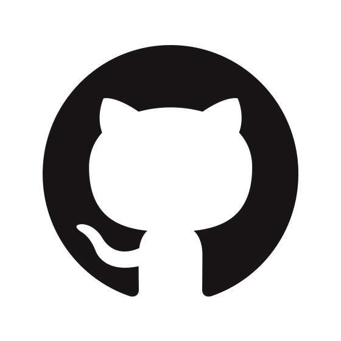
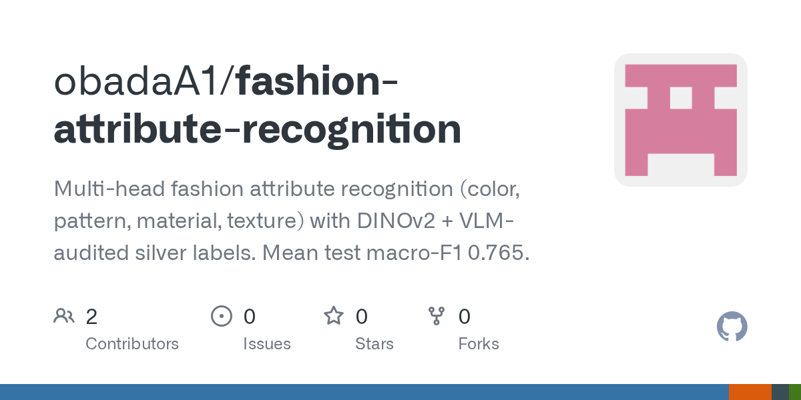
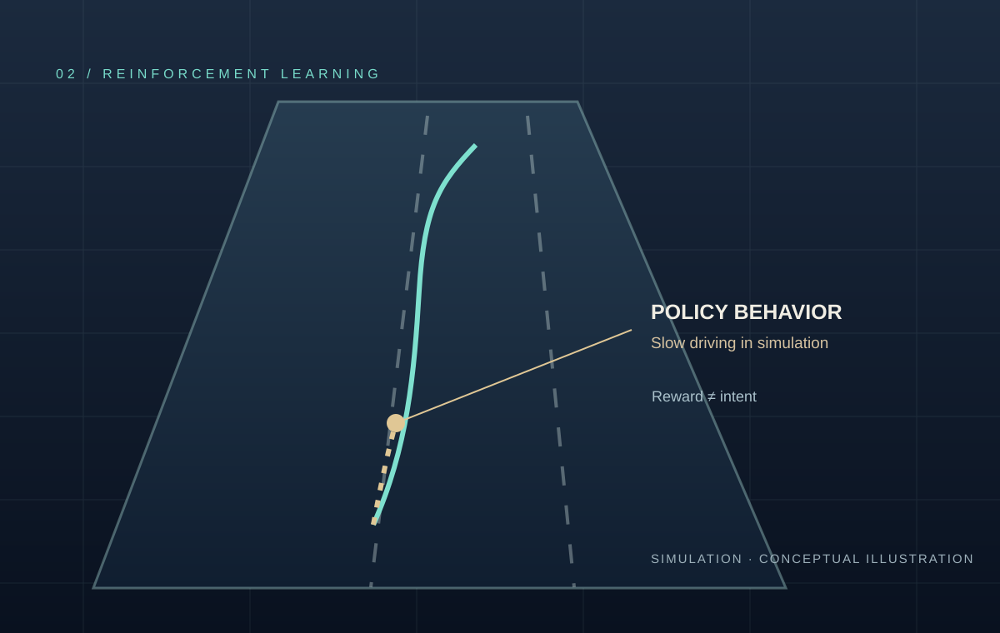
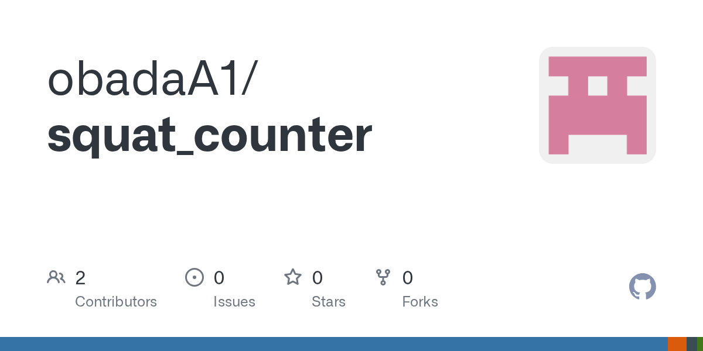
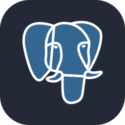
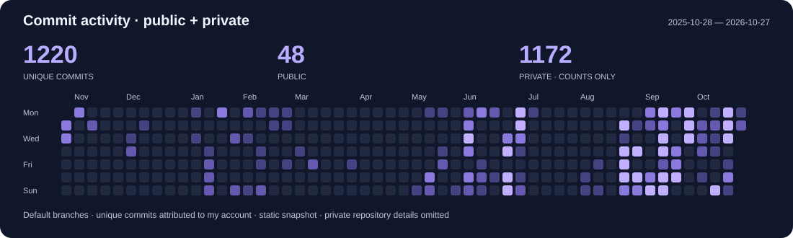

  
  
<b>MSc student at Istanbul Technical University (İTÜ)</b>

  
  &nbsp;
  <a href="https://www.linkedin.com/in/obada-alsehli/"><picture><source media="(prefers-color-scheme: dark)" srcset="assets/profile-social-stats-v1/linkedin-white.png" /></picture></a>
  &nbsp;
  
  &nbsp;
  

I build the software around AI models: **backend services, asynchronous workflows, and integrations across service boundaries**.

I’m pursuing an **MSc in Information & Communications Engineering at İTÜ**, developing an early-stage research direction in image processing and medical imaging. I completed my **BSc in Software Engineering at Bahçeşehir University in 2026**.

<h2 align="center">Selected work</h2>

Computer vision · Backend systems · Reinforcement learning

### Fashion Attribute Recognition

Four heads for **color, pattern, material, and texture**. I compared DINOv2 with ResNet-50, reporting mean test macro-F1 of **0.765 versus 0.649 against silver labels**, not human-verified ground truth. The project includes a FastAPI inference service with upload validation and separate liveness and readiness checks.

[Source code](https://github.com/obadaA1/fashion-attribute-recognition) · [Case study](https://obadaalsehli.com/work/fashion-attribute-recognition)

### IDMS — backend architecture & document workflows

A completed **six-person graduation capstone**. I led backend architecture, worked on asynchronous document workflows, and integrated **team-developed AI and retrieval services** through shared service contracts. My contribution also included technical coordination across those boundaries.

**FastAPI · PostgreSQL · Redis · Qdrant**  
[Project overview](https://obadaalsehli.com/work)

### More public projects

  
  &nbsp;
  

- **[Highway RL Agent](https://github.com/obadaA1/highway-rl-agent):** a PPO experiment in `highway-env` that learned a degenerate slow-driving policy. I examined reward misalignment rather than treating a higher score as successful driving. [Analysis](https://obadaalsehli.com/work/highway-rl-agent). Cover is a conceptual illustration, not a measured trajectory.
- **[Squat Counter API](https://github.com/obadaA1/squat_counter):** video-based repetition counting and movement metrics using MediaPipe Pose Landmarker, signal processing, and FastAPI.

<h2 align="center">Tools I work with</h2>

  
  
  
  
  
  
  
  
  

**Software:** Python · TypeScript · FastAPI · Django/DRF · React  
**Data & infrastructure:** PostgreSQL · Redis · Qdrant · Docker  
**Machine learning:** PyTorch · DINOv2 · MediaPipe · Stable-Baselines3

<b>Current study & research direction</b>

- Image analysis, pattern recognition, and mathematical methods for data analysis and machine learning at İTÜ.
- Image processing and medical imaging as an early-stage research direction—not completed research results.

<h2 align="center">Public + private commit activity</h2>

**Snapshot: 2026-10-27 07:11 UTC.** Unique commits attributed to my account on default branches of accessible public and private non-fork repositories, grouped by commit date (UTC). Deduplicated across repositories. This is not GitHub’s contribution-calendar total; other branches and inaccessible repositories are excluded. Private repository details remain hidden.

[Aggregate chart data](assets/profile-template-v2/commit-counts.json)

---

<a href="https://obadaalsehli.com/"><b>Explore my portfolio and technical writing →</b></a>

Layout adapted from the <a href="https://github.com/Z0ZeroX/Awesome-Profile-README-Templates/blob/main/templates/showcase-collections/IvanMurzak.md">IvanMurzak showcase template</a>. <a href="assets/profile-template-v2/LICENSE.template.txt">Template license</a>.
