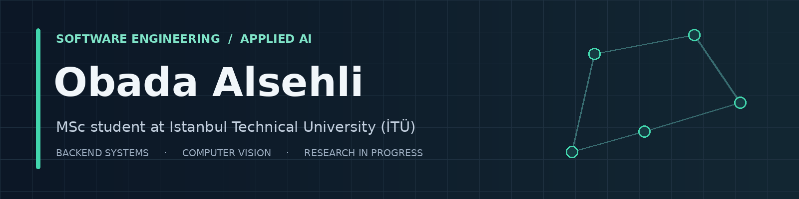
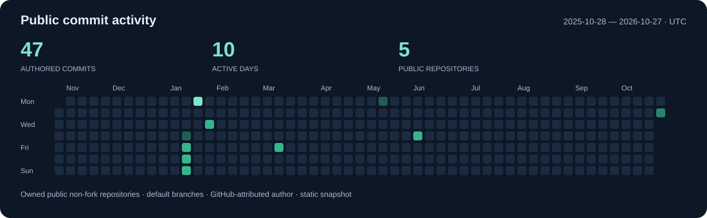

<a href="https://www.linkedin.com/in/obada-alsehli/"><picture><source media="(prefers-color-scheme: dark)" srcset="assets/profile-social-stats-v1/linkedin-white.png" /></picture></a>

**Software engineering · Applied AI · MSc student at İTÜ**

I build backend services and software around AI models: APIs, asynchronous document workflows, and integrations between components developed by a team.

I’m pursuing an **MSc in Information & Communications Engineering at Istanbul Technical University (İTÜ)**, developing a research direction in image processing and medical imaging. My background is in software engineering: I completed my BSc at Bahçeşehir University in 2026.

---

## Selected work

### [Fashion Attribute Recognition](https://github.com/obadaA1/fashion-attribute-recognition)

Four classification heads for clothing **color, pattern, material, and texture**. I compared DINOv2 with ResNet-50, reporting mean test macro-F1 of **0.765 versus 0.649 against silver labels**, not human-verified ground truth. The project includes a FastAPI inference service with input validation and separate liveness and readiness checks.

 

### [IDMS — document workflows and retrieval](https://obadaalsehli.com/work)

A completed **six-person graduation capstone**. I led backend architecture, worked on asynchronous document workflows, and integrated team-developed AI and retrieval services through shared service contracts. My contribution also included technical coordination across those boundaries.

**FastAPI · PostgreSQL · Redis · Qdrant**

### [Highway RL Agent](https://github.com/obadaA1/highway-rl-agent)

A PPO experiment in `highway-env` that learned a degenerate slow-driving policy. I examined why the reward favored survival over the intended driving behavior—a reminder to evaluate what an agent does, not just the score it receives.

 

### [Squat Counter API](https://github.com/obadaA1/squat_counter)

Video-based repetition counting and movement metrics using **MediaPipe Pose Landmarker and FastAPI**, connecting pose estimation with signal processing and an upload API.

---

## Public commit activity

**Snapshot: 2026-10-27 06:50 UTC.** Commits attributed to my GitHub account on the default branches of my owned public, non-fork repositories, counted by author date. This is a static snapshot—not the full contribution graph; private repositories, other branches, and later commits are excluded.

[Inspect the chart data](assets/profile-social-stats-v1/commit-activity.json) · [View my GitHub activity](https://github.com/obadaA1?tab=overview)

## Current focus

- **Study:** image analysis, pattern recognition, and mathematical methods for data analysis and machine learning at İTÜ.
- **Research direction:** image processing and medical imaging, at an early stage.
- **Engineering:** Python services, React applications, relational data modeling, and document-processing integrations.

## Tools I work with

    

**Software:** Python · TypeScript · FastAPI · Django/DRF · React  

  

**Data & infrastructure:** PostgreSQL · Redis · Qdrant · Docker  

**Machine learning:** PyTorch · DINOv2 · MediaPipe · Stable-Baselines3

More context, project limitations, and technical writing: **[obadaalsehli.com](https://obadaalsehli.com/)**.
