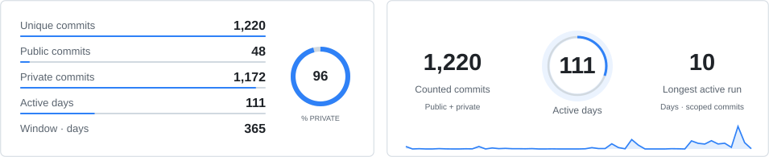
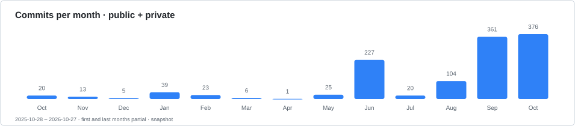
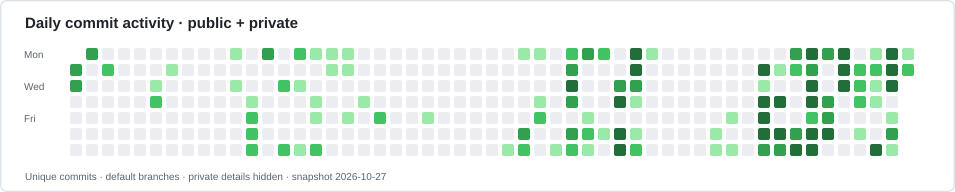
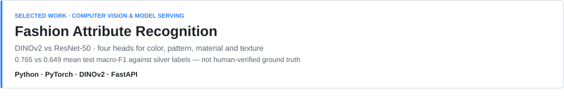
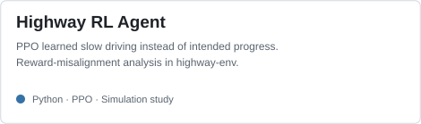
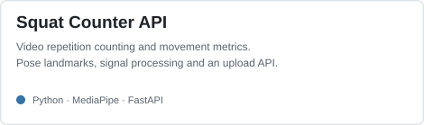
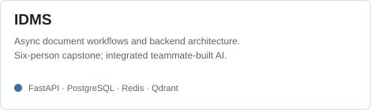
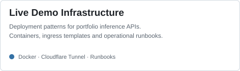

<picture><source media="(prefers-color-scheme: dark)" srcset="assets/showcase-v5/hero-dark.svg" /></picture>

 
Project case studies · Technical writing

<a href="https://www.linkedin.com/in/obada-alsehli/"><picture><source media="(prefers-color-scheme: dark)" srcset="assets/profile-social-stats-v1/linkedin-white.png" /></picture></a> &nbsp;
<a href="mailto:obadaalsohli@gmail.com"><picture><source media="(prefers-color-scheme: dark)" srcset="assets/portfolio-cta-v1/email-dark.svg" /></picture></a>

I build backend services and software around AI models: APIs, asynchronous document workflows, and integrations across service boundaries.

I’m pursuing an **MSc in Information & Communications Engineering at Istanbul Technical University (İTÜ)**, developing an early-stage research direction in image processing and medical imaging. I completed my **BSc in Software Engineering at Bahçeşehir University in 2026**.

> - **Computer vision:** DINOv2 and ResNet-50 compared on four fashion-attribute heads, with silver-label evaluation.
> - **Backend systems:** backend architecture and integration of teammate-developed AI in a six-person IDMS capstone.
> - **Engineering judgment:** examining why a PPO agent’s reward favored slow driving over the intended task.

<picture><source media="(prefers-color-scheme: dark)" srcset="assets/showcase-v5/tech-stack-dark.svg" /></picture>
<picture><source media="(prefers-color-scheme: dark)" srcset="assets/showcase-v5/combined-stats-dark.svg" /></picture>
<picture><source media="(prefers-color-scheme: dark)" srcset="assets/showcase-v5/commits-monthly-dark.svg" /></picture>
<picture><source media="(prefers-color-scheme: dark)" srcset="assets/showcase-v5/activity-pulse-dark.svg" /></picture>

<b>Commit snapshot scope & privacy</b>

**Snapshot: 2026-10-27 07:11 UTC.** 1,220 unique commits: **48 public + 1,172 private**, across accessible non-fork repositories’ default branches, counted by commit date UTC and deduplicated across repositories. The window is 2025-10-28–2026-10-27. Other branches and inaccessible repositories are excluded. This is not GitHub’s contribution-calendar total and does not update automatically. No private repository names, identifiers, messages or code are published.

[Inspect aggregate chart data](assets/showcase-v5/commit-counts.json).

<h1 align="center">AI &amp; Computer Vision</h1>

Model experiments, evaluation, and the software around inference

 

<a href="https://github.com/obadaA1/fashion-attribute-recognition"><picture><source media="(prefers-color-scheme: dark)" srcset="assets/showcase-v5/flagship-dark.svg" /></picture></a>

**Fashion Attribute Recognition:** mean test macro-F1 **0.765 versus 0.649 against silver labels**, not human-verified ground truth. FastAPI serving includes upload validation and separate liveness/readiness checks. [Code](https://github.com/obadaA1/fashion-attribute-recognition) · [Case study](https://obadaalsehli.com/work/fashion-attribute-recognition).

<a href="https://github.com/obadaA1/highway-rl-agent"><picture><source media="(prefers-color-scheme: dark)" srcset="assets/showcase-v5/highway-dark.svg" /></picture></a> &nbsp; <a href="https://github.com/obadaA1/squat_counter"><picture><source media="(prefers-color-scheme: dark)" srcset="assets/showcase-v5/squat-dark.svg" /></picture></a>

[Highway RL analysis](https://obadaalsehli.com/work/highway-rl-agent): the agent learned a degenerate slow-driving policy, not successful autonomous driving. [Squat Counter](https://github.com/obadaA1/squat_counter) connects pose landmarks, signal processing, and an upload API for repetition counts and movement metrics.

<h1 align="center">Backend &amp; Systems</h1>

Document workflows, service contracts, and deployment patterns

 

<a href="https://obadaalsehli.com/work"><picture><source media="(prefers-color-scheme: dark)" srcset="assets/showcase-v5/idms-dark.svg" /></picture></a> &nbsp; <a href="https://github.com/obadaA1/live-demo-infra"><picture><source media="(prefers-color-scheme: dark)" srcset="assets/showcase-v5/infra-dark.svg" /></picture></a>

**IDMS:** I led backend architecture, worked on asynchronous document workflows, integrated **team-developed AI and retrieval services**, and coordinated service boundaries in our completed six-person capstone. [Project overview](https://obadaalsehli.com/work).

**Live Demo Infrastructure:** documented Docker Compose deployment patterns, local-only service bindings, read-only containers, Cloudflare Tunnel ingress, and operational runbooks. [Repository](https://github.com/obadaA1/live-demo-infra).

<b>More about my study and tools</b>

My MSc coursework includes image analysis, pattern recognition, and mathematical methods for data analysis and machine learning. Medical imaging is an early-stage research direction, not a claim of completed research or clinical results.

**Software:** Python · TypeScript · FastAPI · Django/DRF · React  
**Data & infrastructure:** PostgreSQL · Redis · Qdrant · Docker  
**Machine learning:** PyTorch · DINOv2 · MediaPipe · Stable-Baselines3

---

<a href="https://obadaalsehli.com/">Portfolio &amp; technical writing</a> · <a href="https://www.linkedin.com/in/obada-alsehli/">LinkedIn</a> · <a href="mailto:obadaalsohli@gmail.com">Email</a>

Visual composition adapted from the <a href="https://github.com/Z0ZeroX/Awesome-Profile-README-Templates/blob/main/templates/showcase-collections/IvanMurzak.md">IvanMurzak showcase</a>, with locally generated, personalized SVG panels. <a href="assets/showcase-v5/LICENSE.template.txt">Template license</a> · <a href="assets/showcase-v5/SOURCES.md">Sources</a>.
